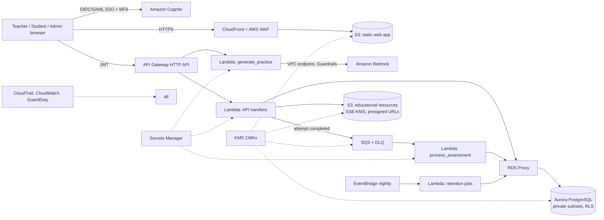

# StudyPatch: AWS architecture

Status: design for production. The prototype in `app/` is a static, offline front end; the pieces in
`db/` and `lambda/` are starting points, tested locally only (schema loads in PostgreSQL; Lambda logic has
unit-level checks; nothing has been deployed to AWS).

## 1. Overview

| Concern | Service / decision |
|---|---|
| Web app | Static front end on S3 behind CloudFront (OAC, TLS 1.2+, security headers, WAF managed rules + rate limit) |
| Auth | Cognito user pools federated to the school IdP (SAML/OIDC). MFA required for staff. Students use school SSO or teacher-issued codes with short sessions |
| API | API Gateway HTTP API + JWT authoriser. Lambda handlers set `app.tenant_id`, `app.user_id`, `app.role` per transaction so PostgreSQL RLS enforces access |
| Structured data | Aurora PostgreSQL Serverless v2, Multi-AZ, private subnets, via RDS Proxy. Schema: `db/schema.sql` |
| Assessment processing | `lambda/process_assessment`: SQS-triggered, idempotent upserts of `skill_evidence` (partial batch failure, DLQ) |
| Generative AI | `lambda/generate_practice` calls Amazon Bedrock (Converse API) through a VPC interface endpoint with a Bedrock Guardrail attached. Model id is configuration, not code |
| Resources | S3 buckets: curriculum documents, teacher-uploaded resources, exports. Block Public Access, SSE-KMS, versioning, presigned URLs (≤5 min), access logs |
| Scheduling | EventBridge → retention Lambda (nightly), metrics roll-ups |
| Observability | CloudWatch structured logs containing IDs and event types only, never names or answers. CloudTrail org trail, GuardDuty, Config rules |

## 2. Generative AI design

1. **Input minimisation.** Prompts contain skill name, misconception hypothesis text and count. Never names, student IDs, class IDs, or raw answers. `generate_practice` rejects payloads containing those keys.
2. **Output contract.** JSON schema (worked example, items with 4 options, one correct, 3 hints, explanation steps).
3. **Automated validation** before storage: single correct option, distinct options, hint/explanation present, correct option untagged; Guardrails block unsafe or off-topic content. In production, arithmetic items are additionally verified by a deterministic solver (as the prototype's generators do) or by a second-pass check; items that fail are discarded.
4. **Human gate.** Stored as `draft`. `CHECK` constraints prevent `approved` without `reviewed_by`/`reviewed_at`. Assignment APIs refuse non-approved sets.
5. **Provenance.** `model_id`, `prompt_version`, validation results and reviewer are stored; students see an "AI-generated, approved by teacher" label.
6. **Controls.** Per-tenant daily generation cap, kill switch per tenant, evaluation set of reviewed prompts re-run on every prompt or model change.
7. **No training use.** Use Bedrock with model-provider data-use terms that exclude customer content from training; record the decision in the DPA.

## 3. Security

- **Encryption:** KMS customer-managed keys for Aurora, S3, SQS, Secrets Manager, CloudWatch Logs; TLS 1.2+ everywhere; RDS `verify-full`.
- **Network:** Lambdas and Aurora in private subnets; no public DB endpoint; VPC endpoints for S3, Bedrock, Secrets Manager, SQS, KMS; egress denied by default.
- **Access:** least-privilege IAM per function; no wildcard resource policies; SCP guardrails; break-glass role with approval and alerts.
- **Tenant isolation:** `tenant_id` on every row with forced RLS. Teachers see only their classes, students only their own rows, admins read aggregates through a suppression view (cells <5 hidden).
- **Application:** server-side authorisation on every call (the prototype's permission matrix mirrors it); input validation; CSP, HSTS, `frame-ancestors 'none'`; dependency scanning; no secrets in the repo.
- **Threats considered:** cross-tenant read (RLS + tests), prompt injection via teacher-entered text (schema validation, Guardrails, no tool use, no student data in context), data exfiltration through exports (pseudonymous IDs, audit event, rate limit), insider access (audit log, JIT admin access).

## 4. Data minimisation and retention

| Data | Purpose | Default retention | Action at end |
|---|---|---|---|
| Student display name | Teacher UI | 12 months after last activity, or 90 days after leaving | Nulled (pseudonym kept) |
| Assessment responses and derived evidence | Reports, progress | 24 months | Deleted |
| Practice responses | Progress | 12 months | Deleted |
| AI practice content | Reuse and audit | While approved and in use + 12 months | Deleted |
| Audit events | Accountability | 36 months | Deleted |
| Exports (S3) | Teacher downloads | 7 days | S3 lifecycle expiry |
| Backups | Recovery | 35 days PITR | Aged out |

Administrators change windows within bounded ranges (`CHECK` constraints in the schema). Not collected: date of birth, contact details, address, health or special-needs information, photographs, free-text student input to AI. Student offboarding triggers deletion and a certificate of erasure in the audit log. Subject-access and deletion requests are served by pseudonym lookup.

## 5. Regulatory notes (not legal advice)

Requirements differ by country and customer: FERPA and COPPA (US), UK GDPR/DPA 2018 and the Age Appropriate Design Code (UK), GDPR (EU), plus state student-privacy laws. Plan for: a DPA with each school, school acting as controller, documented lawful basis, DPIA, sub-processor list (AWS, HubSpot for prospects only), regional data residency, and parental-notice support. Have counsel review before production use with real student data.

## 6. Environments and delivery

Separate AWS accounts for dev, staging, prod (AWS Organizations). Infrastructure as code (CDK or Terraform, not yet written), CI with unit tests, RLS tests (cross-tenant negative tests), SAST and dependency scans, and a staged rollout. Synthetic fictional data only outside production.

## 7. Prototype vs production

| Area | Prototype | Production |
|---|---|---|
| Storage | Browser `localStorage` | Aurora PostgreSQL + RLS |
| AI | Deterministic templates | Bedrock + Guardrails + validation |
| Auth | "Demo as" role switch | Cognito + SSO + MFA, server-side authorisation |
| Resources | None | S3 with presigned access |
| Processing | In-browser engine | `process_assessment` Lambda (same rules) |
| Retention | Preview only | EventBridge-scheduled jobs |
